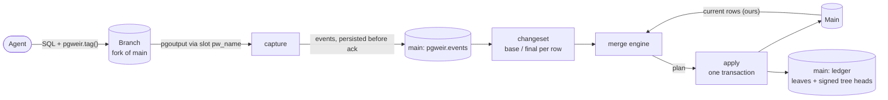
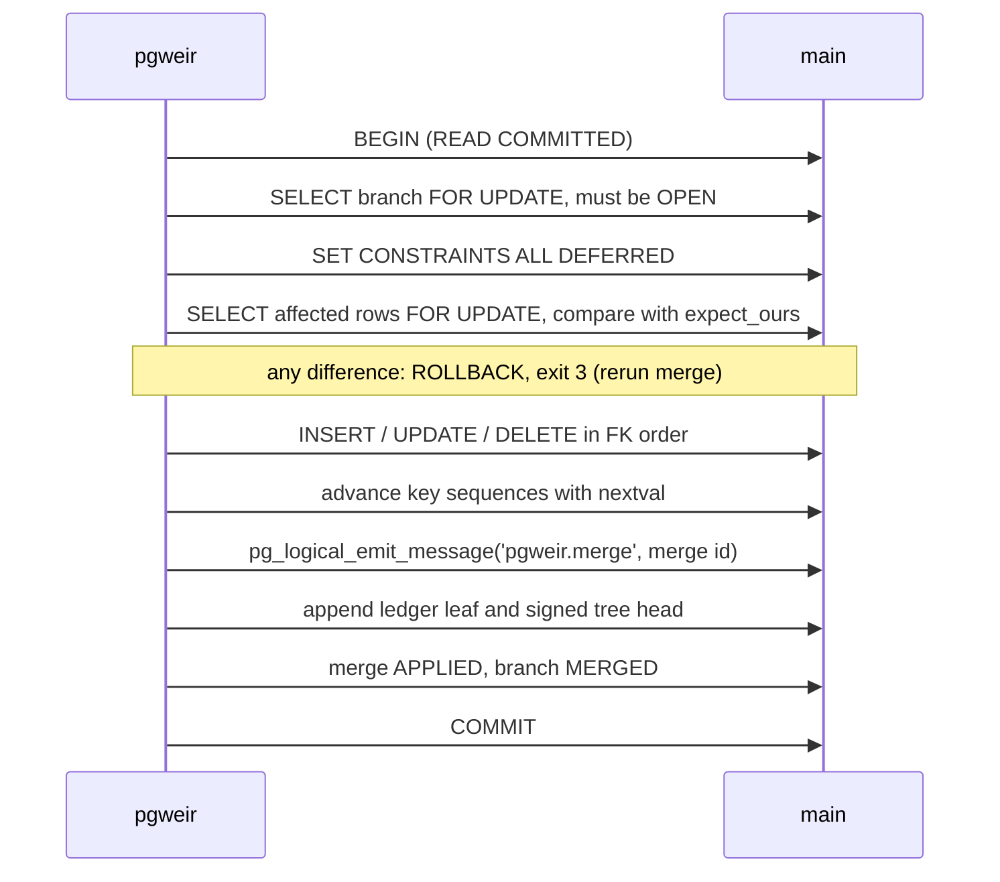
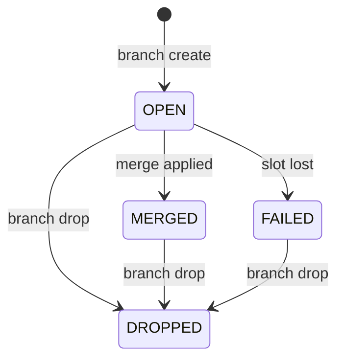

# Design

pgweir lets an agent write to a fork of a Postgres database and merges the
agent's row changes back with a three-way merge. This document describes how,
and why each step is safe. Choices made along the way are logged in
[DECISIONS.md](DECISIONS.md).

## Overview



Three versions of each changed row meet in the merge:

| Name | Meaning | Source |
|---|---|---|
| base (B) | the row when the branch was forked | the first old row captured for that key |
| theirs (T) | the row at the end of the branch's work | the last new row captured for that key |
| ours (O) | the row on main at merge time | read from main |

## Creating a branch

```mermaid
sequenceDiagram
    participant P as pgweir
    participant M as main
    participant F as fork
    P->>M: read config and table definitions, then disconnect
    P->>F: provider.Fork (CREATE DATABASE ... TEMPLATE, Neon branch, or your fork)
    P->>F: check settings, tables and types against main, pgweir.tag() exists
    P->>F: ALTER TABLE ... REPLICA IDENTITY FULL; CREATE PUBLICATION pgweir FOR TABLE ...
    P->>F: CREATE_REPLICATION_SLOT pw_name LOGICAL pgoutput
    F-->>P: consistent point = base_lsn
    P->>M: insert pgweir.branches (OPEN) and capture_progress
    P-->>P: print the fork's connection string
```

Main is never altered for capture: replica identity, the publication and the
slot exist only on the fork, so main's write-ahead log does not grow.

**Invariant: nothing writes to the fork before its slot exists.** The
connection string is printed only after the slot is created. Every change on
the branch is therefore decoded, and with `REPLICA IDENTITY FULL` every UPDATE
and DELETE carries the complete old row. The old row of the *first* change to
a key is that key's row at fork time. pgweir never copies or snapshots the
base; it falls out of the stream.

The order inside the fork matters too: the content of an old row is decided
when the change is written, and pgoutput resolves publication membership from
historic catalog snapshots, so replica identity and the publication are in
place before the slot's consistent point.

The `manual` provider cannot verify the invariant (someone may have written to
the fork before `branch create`), so it records a warning.

## Capture

`pgweir diff` and `pgweir merge` first drain the branch's slot:

1. Read the fork's current WAL position, the *target*.
2. `START_REPLICATION SLOT pw_name LOGICAL <flushed_lsn>` with
   `proto_version '1'`, `publication_names 'pgweir'`, `messages 'true'`.
3. Decode Begin, Relation, Insert, Update, Delete, Message and Commit.
   - **Relation**: the table must be tracked, have replica identity FULL, and
     have the same column names and types as main, in order. Types are
     compared by name (`format_type`), never by OID, so forks restored from a
     dump work. A mismatch aborts with `SCHEMA_DRIFT`.
   - **Message** with prefix `pgweir`: the JSON tag becomes the run for the
     rest of the transaction. Other prefixes are ignored.
   - **Update** must carry the old row (`O`). Unchanged TOAST values (`u`) in
     the new row are copied from the old row. If the primary key changed, the
     update becomes a delete of the old key and an insert of the new one.
   - **Truncate** aborts with `TRUNCATE_NOT_SUPPORTED`.
4. On Commit, insert the transaction's events into `pgweir.events` and set
   `capture_progress.flushed_lsn` to the commit LSN, in one transaction on
   main. Only after that commit succeeds is the slot acknowledged.
5. Stop when a commit at or past the target has been stored, or when the
   server reports it has decoded past the target and sent nothing for
   `--idle-timeout` (default 2s).

Because acknowledgement follows persistence, a crash at any point loses
nothing: the server resends every transaction after the last acknowledged
position. Transactions whose commit LSN is not above `flushed_lsn` were
already stored and are skipped, so nothing is stored twice. When capture ends
idle, it acknowledges the server's last reported position, so the slot does
not hold back WAL that contains no branch changes. `flushed_lsn` (and so
`end_lsn`) stays at the last captured commit.

Capture never uses the `pg_logical_slot_get_*` functions: they advance the
slot before pgweir could store the changes.

### Value equality

Rows are JSON objects mapping column names to the Postgres text
representation (the type's output function) or `null`. Two values are equal
when their text is equal; `NULL` equals only `NULL`.

Output functions depend on session settings, and the fork may carry other
database- or role-level defaults than main (`CREATE DATABASE ... TEMPLATE`
does not copy them). Every connection pgweir opens therefore sends:

```
TimeZone=UTC  DateStyle=ISO, YMD  IntervalStyle=postgres
extra_float_digits=1  bytea_output=hex  lc_monetary=C
```

as startup parameters (they take precedence over database and role
defaults) and verifies them after connecting. Main's rows are read with the
text result format of the protocol, which is the output function. A `::text`
cast is not always the same: `true::text` is `'true'`, the output function
gives `'t'`.

## Changeset

All events of a branch, in order, are grouped by `(schema, table, primary
key)`:

- `base` = old row of the first event (`null` if the first event is an insert)
- `final` = new row of the last event (`null` if the last event is a delete)
- `runs` = the run ids that touched the row, in order of first appearance

A key inserted and then deleted on the branch disappears. The canonical
changeset (`pgweir diff --json`) lists rows sorted by schema, table and
canonical key JSON, the tracked tables' definitions, and the runs.
`changeset_hash = SHA-256(jcs(changeset))`.

## Merge

The merge engine is a pure function of the changeset, main's current rows
and the policy.

| B | T | O | Decision |
|---|---|---|---|
| null | row | absent | INSERT T |
| null | row | O = T | no-op |
| null | row | O ≠ T | conflict `INSERT_INSERT` |
| row | null | absent | no-op (already gone) |
| row | null | O = B | DELETE |
| row | null | O ≠ B | conflict `DELETE_MODIFY` |
| row | row | absent | conflict `MODIFY_DELETE` |
| row | row | O = B | UPDATE to T |
| row | row | O ≠ B | cell-level, below |

Cell level: let TC be the columns the branch changed (B[c] ≠ T[c]) and OC the
columns main changed (B[c] ≠ O[c]). The conflicting cells are
X = { c in TC ∩ OC : T[c] ≠ O[c] }. If X is empty the row merges: main's row
with the branch's values for TC. Otherwise it is a `CELL_CONFLICT` listing
base, ours and theirs for each cell in X. An UPDATE whose result equals main's
row is a no-op.

| Policy | On a conflict |
|---|---|
| `fail` | nothing is applied; the merge is recorded as `CONFLICT` (exit 5) |
| `skip` | the row stays as it is on main (`SKIPPED`); everything else is applied |
| `accept` | the branch wins (`ACCEPTED_THEIRS`): INSERT_INSERT becomes UPDATE to T, DELETE_MODIFY becomes DELETE, MODIFY_DELETE becomes INSERT T, CELL_CONFLICT becomes main's row with every column the branch changed |

Each action records the exact main row it was computed from (`expect_ours`).

## Apply



- **Re-verification.** Rows the plan expects to exist are locked and compared
  with `expect_ours`. Rows it expects to be absent cannot be locked; if
  another session inserts one of those keys meanwhile, the INSERT fails with a
  unique violation on the primary key, which is also reported as "main
  changed, rerun" (exit 3).
- **Order.** Inserts and updates run first, tables in foreign-key order
  (referenced before referencing), rows in the order the branch first touched
  them. Deletes run after, tables in reverse order, rows in the branch's own
  delete order. A child re-pointed to a new parent therefore no longer
  references the old parent when the old parent is deleted. Tables in a
  foreign-key cycle are ordered by name and rely on that order or on
  `DEFERRABLE` constraints.
- **Values** are bound as text and cast to the column type
  (`$1::text::numeric(12,2)`), so Postgres parses exactly the captured text.
  Generated columns are never written; identity columns `GENERATED ALWAYS` are
  inserted with `OVERRIDING SYSTEM VALUE`.
- **Sequences.** The branch started with a copy of each key sequence, so keys
  it generated are unknown to main's sequence. After inserting, pgweir calls
  `nextval` on main's sequence until it has passed the largest inserted key.
  `nextval` never goes backwards, so this is safe while main keeps inserting;
  `setval` could move the sequence back. More than one million calls aborts
  with `SEQUENCE_GAP_TOO_LARGE` and prints the `setval` to run by hand.
- **Errors.** Foreign-key, check, unique (other than the primary-key race)
  and trigger errors roll back the transaction: exit 4, the merge is
  `ABORTED`, the branch stays `OPEN`.

## Ledger

The apply transaction appends one leaf per merge to an RFC 6962 Merkle tree
and signs the new tree head with ed25519. Formats and verification are in
[ledger.md](ledger.md).

## Branch states



A branch merges once. After `MERGED`, `diff` and `merge` are refused; drop it
and create a new branch for further work.

## Exit codes

| Code | Meaning |
|---|---|
| 0 | success; for `merge`: applied, or dry run without conflicts |
| 1 | error; for `verify` and `ledger verify-chain`: invalid |
| 2 | `merge` needs confirmation: pass `--yes` |
| 3 | main changed while the merge was applied: rerun `merge` |
| 4 | Postgres rejected the merge (constraint, trigger); rolled back |
| 5 | conflicts under `--policy fail`; nothing applied |

## Error codes

| Code | Raised when |
|---|---|
| `SCHEMA_DRIFT` | a tracked table's columns, types or key differ between branch and main |
| `TRUNCATE_NOT_SUPPORTED` | the branch truncated a tracked table |
| `REPLICA_IDENTITY_NOT_FULL` | a change arrived without its old row |
| `TOAST_WITHOUT_OLD` | an unchanged TOAST value arrived without an old row |
| `INVALID_TAG` | a `pgweir` message is not a JSON object with a string `run_id` |
| `UNTRACKED_TABLE` | a change to a table outside the tracked set |
| `SLOT_MISSING` | the branch's slot no longer exists; the branch becomes `FAILED` |
| `SESSION_SETTINGS_OVERRIDDEN` | a pinned session setting did not take effect |
| `SEQUENCE_GAP_TOO_LARGE` | advancing a key sequence needs more than 10^6 calls |
